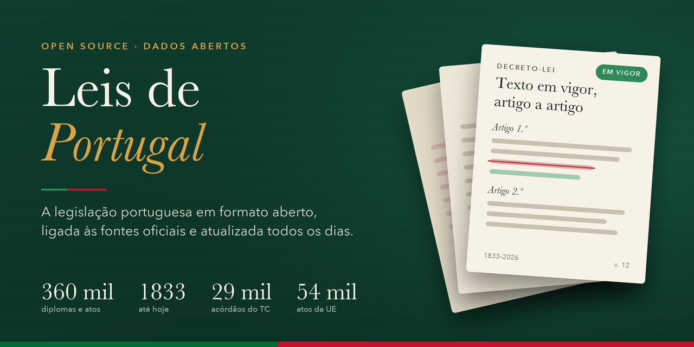

# Leis de Portugal

**Legislação portuguesa em formato aberto, estruturado e versionado.**

O `leis-portugal` é um projeto open-source que pretende reunir e organizar legislação portuguesa num repositório público, com textos legíveis por pessoas e máquinas, metadados normalizados, ligações às fontes oficiais e um histórico de alterações verificável.

O objetivo é tornar o ordenamento jurídico português mais acessível, pesquisável e reutilizável, criando uma base que possa servir cidadãos, juristas, investigadores, jornalistas, programadores e aplicações de inteligência artificial.

> **Estado do projeto:** em desenvolvimento ativo. Os números exatos e atualizados estão sempre em [`reports/COBERTURA.md`](reports/COBERTURA.md) e [`reports/PROGRESSO.md`](reports/PROGRESSO.md), gerados a partir dos próprios dados.

### O que já existe (novembro de 2026)

| | |
|---|---|
| Registos | ~460 mil: ~375 mil da legislação nacional (1.ª Série desde 1833, praticamente completa face aos sitemaps do DRE, e parte da 2.ª Série), ~31 mil regionais (Açores e Madeira, incluindo o catálogo do Jornal Oficial dos Açores) e ~54 mil atos da UE (96 % dos que estão em vigor) |
| Texto | ~246 mil com texto pesquisável; ~70 mil só com o PDF oficial (sobretudo 1910–1959, digitalizações); ~24 mil só com metadados, porque a fonte não tem texto nem PDF |
| Versões | ~10 mil diplomas e atos com o histórico de versões (`.versoes.json`) e consulta do texto numa data (`version-at`) |
| Texto em vigor consolidado pelo leis-portugal | mais de 2,6 mil diplomas que o DRE dá como alterados mas não consolida: alterações aplicadas por regras ou por um LLM e verificadas às cegas por outro modelo; marcados como **sem valor oficial** (ver [`consolidacao/`](consolidacao/README.md)) |
| Relações | ~1,04 milhões de relações (alterações, revogações, retificações, citações, transposições); ~89% apontam para um documento do acervo |
| Decisões (fora da legislação) | 122.223 decisões da CNPD, todas as do histórico de 1994 a 2026 (114.331 autorizações anteriores ao RGPD), 70 % com texto (nos pareceres e deliberações só 6 a 7 %, porque a maioria dos PDF são digitalizações); 29.392 acórdãos do Tribunal Constitucional, todos os de 1983 a 2026 que têm texto no site, e 5.320 decisões sumárias de 1998 a 2026; 8.966 normas julgadas tiradas da decisão dos de 1983 a 2026, com 371 declarações de inconstitucionalidade com força obrigatória geral, ligadas ao diploma (precisão medida às cegas: 90 % em 2016–2026, 78 % antes de 2016) |
| Fontes operacionais | Diário da República Eletrónico (DRE), EUR-Lex/CELLAR, CNPD e Tribunal Constitucional |
| Atualização | Diária, por GitHub Actions |
| Exportação | Índice de relações (JSONL), SQLite e Parquet com os metadados (`leis-portugal export`) |
| Perguntas (protótipo) | Pesquisa por artigo com reranker e resposta só a partir dos artigos encontrados, com "não sei" quando não há base; medição com juízes às cegas em [`rag/README.md`](rag/README.md) |

### O que o protótipo de perguntas consegue hoje

Em palavras simples, medido em mais de mil perguntas em novembro de 2026:

- **Quando responde, acerta em cerca de 19 em cada 20 perguntas** (95%). Quando a pergunta indica a lei ou o artigo, acerta praticamente em todas.
- **Responde a mais de 8 em cada 10 perguntas.** Nas outras diz "não sei", em vez de inventar. Ao todo, cerca de 4 em cada 5 perguntas recebem uma resposta certa.
- **Mostra sempre de onde vem a resposta:** a lei, o artigo e a redação em vigor na data. Se a lei foi revogada, diz qual foi a lei que a revogou.
- **Não responde sobre leis que não existem:** recusou 78 de 80 perguntas deste tipo.

O que ainda não consegue (sem isto, os números enganam):

- **Não substitui um advogado.** As perguntas testadas são do tipo das perguntas frequentes ou sobre artigos concretos. Ainda não se mediu a análise de um caso, a interpretação da lei nem o uso da jurisprudência.
- **Ainda nenhum jurista reviu as respostas.** Foram julgadas às cegas por quatro juízes, mas os quatro são o mesmo modelo de IA.
- **Leis alteradas sem texto atualizado:** responde a menos de metade destas perguntas.
- **Perguntas que precisam de dois artigos** ficam sem resposta em cerca de 1 em cada 4.
- **É um protótipo:** as medições foram feitas com sessões do Claude, não com um serviço em produção.

Os números por tipo de pergunta estão em [Cobertura e progresso](#cobertura-e-progresso) e o pormenor em [`rag/README.md`](rag/README.md). Para divulgar o projeto, há textos prontos e a lista do que não se pode afirmar em [`COMUNICACAO.md`](COMUNICACAO.md).

**Para o experimentar no teu computador:** a aplicação para Mac e Windows, gratuita e com um passo a passo, descarrega-se em [joaobarrosodev.github.io/leis-portugal](https://joaobarrosodev.github.io/leis-portugal/) ([`app/`](app/README.md)). A partir do repositório, com a tua chave da IA (Claude, OpenAI ou Gemini): [`COMO-USAR.md`](COMO-USAR.md), ou a página no browser com `./perguntar --web`.

## Índice

- [Objetivos](#objetivos)
- [Princípios](#princípios)
- [Fontes oficiais](#fontes-oficiais)
- [Âmbito da coleção](#âmbito-da-coleção)
- [Estrutura do repositório](#estrutura-do-repositório)
- [Formato dos documentos](#formato-dos-documentos)
- [Consultar a legislação](#consultar-a-legislação)
- [Usar os dados](#usar-os-dados)
- [Atualização automática](#atualização-automática)
- [Histórico e versões](#histórico-e-versões)
- [Cobertura e progresso](#cobertura-e-progresso)
- [Qualidade e validação](#qualidade-e-validação)
- [Desenvolvimento](#desenvolvimento)
- [Contribuir](#contribuir)
- [Limitações e utilização responsável](#limitações-e-utilização-responsável)
- [Licenciamento e reutilização dos dados](#licenciamento-e-reutilização-dos-dados)
- [Agradecimentos](#agradecimentos)

## Objetivos

O projeto procura construir, de forma incremental, uma coleção organizada de diplomas legais portugueses que seja:

- **Aberta:** acessível gratuitamente através do GitHub.
- **Estruturada:** organizada por tipo de diploma, data, número e outras propriedades relevantes.
- **Legível:** disponível em formatos simples, como Markdown, sem exigir software jurídico proprietário.
- **Rastreável:** cada documento deve identificar a respetiva fonte oficial.
- **Versionada:** o Git permite consultar as alterações registadas no próprio repositório.
- **Automatizável:** recolha, conversão, normalização e validação através de ferramentas reproduzíveis.
- **Auditável:** as lacunas conhecidas, os erros e o estado da cobertura devem ser documentados.
- **Preparada para integração:** os dados devem poder ser utilizados em motores de pesquisa, sistemas de análise documental e aplicações de IA.

A ambição é evoluir para uma base abrangente do ordenamento jurídico português, sem confundir o objetivo de cobertura total com aquilo que já foi efetivamente recolhido e validado.

## Princípios

### A fonte oficial é a referência

Cada documento deve incluir uma ligação para a sua publicação ou página oficial. Quando existam várias versões, devem distinguir-se o diploma original, as alterações posteriores e eventuais textos consolidados.

### Não confundir publicação com consolidação

A publicação oficial de um diploma e uma versão consolidada são representações diferentes.

Uma consolidação pode facilitar a leitura da redação resultante de alterações sucessivas, mas não deve ser apresentada como se fosse o diploma original. Sempre que possível, devem ser preservadas as referências necessárias para consultar ambas as versões.

Quando o DRE não consolida um diploma alterado, o `leis-portugal` pode produzir o texto em vigor. Esses registos têm `version.kind: consolidated` e o rótulo "Versão consolidada pelo leis-portugal, sem valor oficial", cada artigo alterado leva uma nota com o diploma que o alterou, e o `.versoes.json` guarda o original publicado ao lado da versão consolidada. Só entram depois de verificados às cegas por outro modelo; uma consolidação do próprio DRE, quando existir, substitui-os. O método e o que falha estão em [`consolidacao/README.md`](consolidacao/README.md).

### Não inventar cobertura

O repositório deve indicar explicitamente o que foi recolhido, o que está validado, o que falta e quais as limitações conhecidas. A existência de uma categoria na estrutura não significa que a respetiva coleção esteja completa.

### Automatizar com transparência

Os processos automáticos devem ser reproduzíveis, testáveis e respeitar as condições de acesso e reutilização das fontes. Erros de conversão não devem ser ocultados.

## Fontes oficiais

O projeto privilegia fontes primárias e páginas institucionais.

| Fonte | Utilização | Estado |
|---|---|---|
| [Diário da República Eletrónico](https://diariodarepublica.pt/) | Publicação oficial de diplomas, legislação consolidada e histórico de versões, análise jurídica (alterações, retificações) e descritores. | Operacional |
| Jornal Oficial dos Açores (catálogo guardado pelo DRE) | Legislação regional dos Açores, com a publicação no Jornal Oficial da Região. | Operacional, através do DRE |
| [EUR-Lex / CELLAR](https://eur-lex.europa.eu/) | Regulamentos, diretivas e decisões da UE, versões consolidadas, EuroVoc e relações. | Operacional |
| [Assembleia da República](https://www.parlamento.pt/) | Informação parlamentar e trabalhos preparatórios. | Planeada |
| [Tribunal Constitucional](https://www.tribunalconstitucional.pt/) | Acórdãos de 1983 a 2026, numa coleção separada da legislação (`data/jurisprudencia/`), ligados ao DR quando lá publicados. | Operacional |
| [Supremo Tribunal de Justiça](https://www.stj.pt/) | Jurisprudência, numa coleção separada. | Planeada (por agora só os acórdãos publicados no DR) |
| [Supremo Tribunal Administrativo](https://www.stadministrativo.pt/) | Jurisprudência administrativa e fiscal. | Planeada (por agora só os acórdãos publicados no DR) |
| [Comissão Nacional de Proteção de Dados](https://www.cnpd.pt/) | Pareceres, deliberações, diretrizes, regulamentos, registos e autorizações (1994–2026), numa coleção separada (`data/entidades/`). | Operacional |

O registo das fontes, com o mecanismo de acesso, o âmbito verificado, os limites e as condições de reutilização de cada uma, está em [`config/sources.yml`](config/sources.yml).

Esta lista identifica fontes de referência e possíveis áreas de integração; não constitui uma declaração de que todas as fontes já estão ligadas aos processos automáticos.

Cada integração deve documentar:

- A entidade responsável pela fonte.
- O endereço e o mecanismo de acesso utilizados.
- Os tipos de documentos disponíveis.
- O período temporal abrangido.
- A data da última recolha bem-sucedida.
- As condições de acesso e reutilização aplicáveis.
- As limitações técnicas ou documentais conhecidas.

O acesso público a uma página não implica, por si só, que todos os seus conteúdos possam ser recolhidos ou redistribuídos sem restrições.

## Âmbito da coleção

A estrutura foi pensada para crescer por etapas.

### 1. Legislação nacional

- Constituição da República Portuguesa.
- Leis constitucionais e leis de revisão constitucional.
- Leis e leis orgânicas.
- Decretos-leis.
- Decretos regulamentares.
- Decretos e outros atos normativos publicados oficialmente.
- Resoluções, portarias, despachos e regulamentos, de acordo com a sua natureza e o âmbito definido.
- Diplomas de aprovação, alteração, suspensão, revogação ou republicação de outros atos.

A classificação deve respeitar a designação oficial e a natureza jurídica de cada instrumento.

### 2. Direito da União Europeia

- Regulamentos.
- Diretivas.
- Decisões.
- Tratados e outros atos relevantes.
- Referências à transposição nacional, quando verificáveis.

Os atos europeus devem manter os seus identificadores próprios, como o número CELEX, quando disponível, e a ligação ao EUR-Lex.

### 3. Legislação regional e local

Estão integrados os diplomas das Regiões Autónomas publicados no Diário da República (decretos legislativos regionais, decretos regulamentares regionais, resoluções das assembleias legislativas…) e o catálogo do Jornal Oficial dos Açores que o DRE guarda (resoluções, portarias, despachos normativos… do Governo Regional), com a referência à publicação no Jornal Oficial da Região. O Jornal Oficial da Madeira e os atos municipais ainda não estão integrados.

Esta coleção exige atenção especial às diferenças entre entidades emissoras, séries de publicação, nomenclaturas e sistemas documentais.

### 4. Regulamentação e atos de entidades públicas

Poderão ser incluídos atos regulamentares de entidades administrativas e reguladoras, desde que identificados separadamente da legislação parlamentar e governamental.

### 5. Jurisprudência e materiais complementares

Decisões judiciais, acórdãos, jurisprudência uniformizada, orientações administrativas, trabalhos preparatórios e documentos explicativos não devem ser confundidos com diplomas legislativos.

Se forem integrados, devem ter diretórios, metadados e regras de validação próprios.

## Estrutura do repositório

```text
leis-portugal/
├── config/
│   ├── sources.yml            # registo das fontes, estado e condições de reutilização
│   └── document_types.yml     # tipos canónicos de diploma, grafias alternativas e pastas
├── schemas/                   # JSON Schema dos registos e das fontes
├── data/
│   ├── portugal/              # legislação nacional (1.ª Série do DR)
│   │   ├── leis/<ano>/lei-29-2026.md
│   │   ├── decretos-leis/<ano>/decreto-lei-140-2009.md
│   │   ├── portarias/ … declaracoes-retificacao/ … (um diretório por tipo)
│   │   └── serie-ii/          # documentos da 2.ª Série, que têm numeração própria
│   ├── regional/
│   │   ├── acores/            # legislação regional publicada no DR e catálogo do Jornal Oficial dos Açores
│   │   └── madeira/
│   └── european_union/        # regulamentos, diretivas e decisões (EUR-Lex), mesma informação que os diplomas portugueses
│       ├── regulations/<ano>/regulamento-ue-2016-679.md
│       ├── directives/<ano>/diretiva-ue-2022-2555.md
│       └── decisions/<ano>/decisao-ue-2019-1234.md
│   ├── entidades/             # decisões de entidades administrativas, separadas da legislação
│   │   └── cnpd/pareceres/<ano>/parecer-72-2025.md   # e deliberacoes/, diretrizes/, regulamentos/, registos/, autorizacoes/
│   └── jurisprudencia/        # acórdãos recolhidos nos sites dos tribunais, separados da legislação
│       └── tribunal-constitucional/<ano>/acordao-tc-500-2024.md
├── consolidacao/              # texto em vigor dos diplomas alterados que o DRE não consolida
├── rag/                       # protótipo de perguntas: índice por artigo, pesquisa, resposta e medição
├── avaliacao/                 # perguntas de avaliação do protótipo (as privadas ficam fora do git)
├── reports/                   # cobertura, progresso e falhas, gerados a partir de data/
├── exports/                   # gerado por `leis-portugal export` (fora do git)
├── scripts/                   # atualização diária
├── src/leis_portugal/         # recolha, conversão, validação, ligações, exportação e relatórios
└── tests/
```

Cada diploma é um ficheiro `data/<âmbito>/<tipo>/<ano de publicação>/<tipo>-<número>.md`. Quando dois diplomas distintos teriam o mesmo nome (por exemplo, numerações repetidas em diplomas antigos), o segundo recebe o id do DRE como sufixo. Os diplomas com histórico de versões têm ao lado um `<diploma>.versoes.json` (e, nos históricos acima de 50 MB, a pasta `<diploma>.versoes/` com os blocos de fragmentos).

## Arquitetura

O código em `src/leis_portugal/` está organizado em camadas, e cada camada só depende das que estão abaixo dela:

```text
cli/             comandos: lê argumentos, chama um serviço, imprime o resultado
services/        casos de uso: recolher (DRE, EUR-Lex, histórico consolidado, em falta, referidos), cobertura pelos sitemaps,
                 ligar e resolver referências, exportar, validar, relatar
sources/         uma pasta por fonte, separando transporte (client.py) e conversão para o modelo (mapper.py)
  dre/           cliente OutSystems, sitemaps, mapeamento (DR e catálogo dos Açores), HTML -> Markdown, consolidados
  eurlex/        cliente CELLAR (SPARQL), mapeamento, XHTML -> Markdown
  cnpd.py        histórico de decisões da CNPD (listagens HTML e PDF), com o texto extraído do PDF (pdftext.py)
  tc.py          listagens anuais e páginas HTML dos acórdãos do Tribunal Constitucional
infrastructure/  HTTP comum (espera e novas tentativas), Markdown/YAML, esquemas, configuração e o repositório `Acervo`
domain/          modelo tipado `LegalRecord`, formato do histórico de versões, identificadores, tipos de diploma,
                 relações e resolução de referências (ELI, numeração); sem rede nem ficheiros
```

- **`LegalRecord`** é o modelo de um registo. `from_dict`/`to_dict` fazem a ida e volta exata do front matter, por isso o formato em disco é estável.
- **`Acervo`** é o único sítio que lê e escreve em `data/`. Trata dos caminhos, do índice id → ficheiro, da validação, das colisões, da precedência entre fontes (consolidado > publicado; DRE > importação), da preservação de datas e dos ficheiros de versões.
- **As fontes** devolvem um `SourceDocument` (registo + texto + bytes oficiais) e não escrevem nada. Os serviços decidem como gravar através de uma `SavePolicy`.
- **Erros:** os erros esperados (`LeisPortugalError`: fonte, armazenamento, registo inválido) são registados por documento e a recolha continua; qualquer outro erro é um bug e interrompe a execução.

## Formato dos documentos

Cada ficheiro é Markdown com metadados YAML, validados por [`schemas/legal_document.schema.json`](schemas/legal_document.schema.json). Exemplo (resumido) de um registo real:

```yaml
---
schema_version: '1.0'
id: pt:dre:494543:por
title: Decreto-Lei n.º 140/2009
summary: Estabelece o regime jurídico dos estudos, projectos, relatórios, obras ou intervenções sobre bens culturais…
jurisdiction: portugal
territory: null
document_type: decreto-lei
document_type_label: Decreto-Lei
issuing_authority: [Ministério da Cultura]
official_number: 140/2009
publication_date: '2009-06-15'
publication:
  gazette: Diário da República
  reference: Diário da República n.º 113/2009, Série I de 2009-06-15
  pages: 3653 - 3659
  pdf_url: https://files.diariodarepublica.pt/1s/2009/06/11300/0365303659.pdf
legal_status: in_force
version: {kind: consolidated, consolidation_date: '2024-11-22'}
identifiers:
  eli: https://data.dre.pt/eli/dec-lei/140/2009/p/cons/20241122/pt/html
  dre: '494543'
  dre_path: /dr/detalhe/decreto-lei/140-2009-494543
source: {id: dre, official_url: https://diariodarepublica.pt/dr/detalhe/decreto-lei/140-2009-494543}
subjects: [Património Cultural, Vistoria]
relationships:
- type: amended_by
  target: pt:dre:897548401:por
  label: Alterados a partir de 23 de novembro de 2024 os artigos 17.º, 18.º, … pelo(a) Decreto-Lei n.º 90/2024 …
  date: '2024-11-22'
- type: cites
  target: pt:dre:629790:por
  source: http://data.dre.pt/eli/lei/107/2001/09/08/p/dre
article_structure: {article_count: 43, section_count: 6}
---

# Decreto-Lei n.º 140/2009

###### Artigo 1.º — Objecto e âmbito de aplicação
```

### Regras para os metadados

- `id`: `pt:dre:<id DRE>:por` para diplomas portugueses e `eu:celex:<CELEX>:por` para atos da UE, ambos estáveis entre versões.
- `document_type`: vocabulário controlado em `config/document_types.yml`; as grafias do DRE, incluindo as antigas (`declaracao-rectificacao`, `…-extracto`, …), são normalizadas.
- `jurisdiction` e `territory`: `regional` com `acores`/`madeira` para legislação das regiões autónomas.
- `publication`: jornal oficial, número, série, suplemento, páginas e PDF oficial.
- `version.kind`: `original` (texto publicado) ou `consolidated` (consolidação do DRE, com `consolidation_date`).
- `relationships`: `amended_by`/`amends`, `repealed_by`/`repeals`, `corrected_by`/`corrects`, `cites`/`cited_by`, `transposes`/`transposed_by` (diretivas da UE transpostas por diplomas portugueses) e `interpreted_by` (acórdãos do TJUE sobre um ato da UE). O alvo pode ser:
  - um id do acervo (`pt:dre:<id>:por`, `eu:celex:<CELEX>:por`);
  - `celex:<CELEX>` para atos da UE (presentes ou não no acervo);
  - uma referência por número (`pt:numero:decreto-lei:40-A/2026`), quando a fonte só descreve a relação em texto;
  - um ELI (`eli:…`) de um documento que o acervo ainda não tem. Os ELI de documentos presentes são resolvidos pelo `leis-portugal link` para o id, com o URL original em `source`.

  O índice de relações (`leis-portugal export`) acrescenta a cada relação o id resolvido (`target_id`).
- `notes`: avisos sobre o registo. "Fonte sem texto: …" indica que a fonte oficial não publica o texto (o registo tem só os metadados, ou mantém o texto que já tinha).
- `source`, `provenance` e `integrity`: a fonte oficial (DRE ou EUR-Lex), quando e como foi obtido, e o SHA-256 dos bytes recebidos (`official_source_content_bytes`). Sem texto na fonte, o SHA-256 identifica a resposta de metadados.

Não se inferem datas, estados de vigência, revogações ou outros efeitos jurídicos apenas a partir do título ou da existência de alterações posteriores.

### Identificação das versões

Quando uma fonte disponibilizar mais do que uma representação do mesmo diploma, estas devem ser distinguidas explicitamente.

Exemplos de categorias documentais:

- `original`: texto do ato publicado originalmente.
- `consolidado`: texto consolidado disponibilizado por uma fonte.
- `alteracao`: ato que modifica outro diploma.
- `historico`: versão associada a um momento temporal específico.

Uma versão consolidada não deve substituir silenciosamente o original. Sempre que possível, devem existir referências cruzadas entre o diploma de origem, os atos modificativos e a versão consolidada.

## Consultar a legislação

### No GitHub

É possível navegar pelos diretórios, abrir ficheiros Markdown e utilizar a pesquisa do GitHub para localizar diplomas por título, número, identificador ou expressões do texto.

A qualidade dos resultados depende da cobertura do acervo e da forma como os documentos foram normalizados.

### Clonar o repositório

```bash
git clone https://github.com/joaobarrosodev/leis-portugal.git
cd leis-portugal
```

Substitua `joaobarrosodev` pelo nome de utilizador ou organização que aloja o projeto.

### Pesquisar localmente

Depois de clonar o repositório, pode pesquisar o conteúdo com ferramentas habituais.

Com `grep`:

```bash
grep -Rli --include="*.md" "proteção de dados" data/portugal/leis/
```

Com `find`:

```bash
find data/portugal/decretos-leis/2024 -type f -name "*.md"
```

## Usar os dados

### Em Markdown

Cada registo é um ficheiro autónomo: os metadados no front matter YAML e o texto em Markdown, com os artigos em cabeçalhos `###### Artigo N.º — Epígrafe`. Para dividir o texto por artigo (por exemplo, para pesquisa semântica), basta cortar nesses cabeçalhos.

### Tabelas e índice de relações

`leis-portugal export` gera em `exports/` o SQLite e o Parquet com os metadados de todos os registos e as relações (ver [Exportação para pesquisa](#exportação-para-pesquisa)). Exemplos:

```bash
sqlite3 exports/leis-portugal.sqlite "SELECT id, title FROM documentos WHERE document_type = 'lei' AND publication_date >= '2026-01-01' AND text_quality = 'texto'"
```

```python
import duckdb

duckdb.sql("""
    SELECT d.title, r.type, r.date
    FROM 'exports/relacoes.parquet' r JOIN 'exports/documentos.parquet' d ON d.id = r.source_id
    WHERE r.target_id = 'eu:celex:32016R0679:por'
""").show()
```

### Para pesquisa e aplicações de IA

- Filtre por `text_quality = 'texto'` para indexar só documentos com texto (os restantes têm só o PDF oficial ou só os metadados).
- Use o id (`pt:dre:…`, `eu:celex:…`) como identificador estável e a ligação `official_url` como citação.
- Use `relacoes` para seguir alterações, revogações e transposições a partir de um resultado.
- Para o texto em vigor numa data, use `leis-portugal version-at <id> --date AAAA-MM-DD` nos diplomas com histórico de versões.
- Confirme sempre o texto na fonte oficial antes de o usar num contexto jurídico (ver [Limitações](#limitações-e-utilização-responsável)).

## Atualização automática

A atualização do acervo deve ser assegurada por processos automatizados, com execução controlada e resultados auditáveis.

O fluxo de trabalho previsto é:

1. Consultar as fontes autorizadas e os respetivos índices.
2. Identificar documentos novos ou alterados.
3. Recolher o conteúdo e os metadados disponíveis.
4. Preservar a ligação à origem e, quando permitido, uma referência ao documento original.
5. Converter o conteúdo para o formato definido pelo projeto.
6. Normalizar os metadados e a organização dos ficheiros.
7. Validar a estrutura, os identificadores e a integridade dos documentos.
8. Produzir relatórios de recolha, alterações, falhas e cobertura.
9. Registar as alterações no Git após as verificações aplicáveis.

### GitHub Actions

O workflow [`.github/workflows/atualizacao-diaria.yml`](.github/workflows/atualizacao-diaria.yml) corre todos os dias às 06:15 UTC e executa [`scripts/atualizacao_diaria.sh`](scripts/atualizacao_diaria.sh) para o dia anterior (hora de Lisboa):

1. `leis-portugal collect dre` — diplomas da 1.ª Série do Diário da República.
2. `leis-portugal collect eurlex` — regulamentos, diretivas e decisões publicados no Jornal Oficial da UE.
3. `leis-portugal collect tc` e `leis-portugal collect cnpd` — acórdãos do Tribunal Constitucional e decisões da CNPD que ainda não estão no acervo. Estes sites não se pesquisam por data: a listagem do ano anterior e do atual é relida e só o que é novo é descarregado (cerca de 45 s e 30 s). Os PDF digitalizados da CNPD ficam sem texto até haver OCR (`collect cnpd --without-text`, num Mac).
4. `leis-portugal link` — ligações entre os diplomas portugueses e os atos da UE, e referências por ELI resolvidas para ids do acervo.
5. `leis-portugal validate` — se a validação falhar, nada é publicado.
6. `leis-portugal reports` — cobertura e progresso.

As listas de falhas do TC e da CNPD (`reports/tc_failures.jsonl`, `reports/cnpd_failures.jsonl`) acumulam entre recolhas: uma recolha de dois anos só substitui as entradas desses anos, e uma página que volta a falhar mantém a nota que lhe foi acrescentada.

As alterações são publicadas no `main` num commit "Atualização diária: DRE, EUR-Lex, TC e CNPD de AAAA-MM-DD" feito por `github-actions[bot]`. Se uma das recolhas falhar (por exemplo, depois de um deploy do DRE), o que foi recolhido e validado é publicado na mesma e a execução fica marcada como falhada.

Para recuperar dias em falta, execute o workflow manualmente em *Actions → Atualização diária → Run workflow* com as datas `from` e `to`. Localmente:

```bash
scripts/atualizacao_diaria.sh 2026-10-01 2026-10-22
```

Limitações atuais da atualização diária, a resolver: recolhe só o dia anterior (um dia falhado tem de ser recuperado à mão), não repete automaticamente as falhas temporárias e não atualiza sozinha o histórico de versões consolidadas nem os diplomas alterados. Entretanto, `collect dre --missing` (sitemaps do DRE) e `collect dre-consolidated --stale` cobrem estas lacunas quando executados.

## Histórico e versões

O Git é utilizado para registar as alterações aos ficheiros e aos processos de recolha.

Este histórico pode ajudar a identificar:

- Quando foi introduzido ou modificado um ficheiro.
- Que alterações textuais foram registadas.
- Quando foi corrigido um erro de conversão.
- Que alterações foram efetuadas aos metadados.
- Que alterações resultaram de uma nova recolha.

O histórico do repositório não deve ser interpretado automaticamente como um registo jurídico completo da vigência de cada diploma. A data de um commit é a data do registo da alteração no Git, não necessariamente a data de publicação, entrada em vigor ou produção de efeitos jurídicos.

Sempre que possível, o projeto deve manter as datas e referências oficiais separadas das datas de recolha e de versionamento.

## Cobertura e progresso

A cobertura é medida a partir dos próprios dados por `leis-portugal reports`, sem estimativas:

- [`reports/COBERTURA.md`](reports/COBERTURA.md): documentos por jurisdição, região, tipo, ano, estado de vigência, versão e qualidade do texto; relações por tipo; cobertura face aos sitemaps do DRE (o que o DRE lista, o que o acervo tem, o que falta); falhas de recolha por motivo; lacunas conhecidas.
- [`reports/PROGRESSO.md`](reports/PROGRESSO.md): estado de cada componente e fonte, e próximos passos.
- `reports/*_failures.jsonl`: um documento por linha que não foi possível recolher, com o motivo (`sem_texto_na_fonte`, `erro_de_acesso`, `metadados_em_falta`…). "A fonte não tem o texto" não é um erro: o documento existe, mas a fonte não publica o texto (em formato eletrónico ou em português).

### Cobertura em percentagem (12 de novembro de 2026, 2h)

**Legislação portuguesa, face aos sitemaps do DRE** (comparação de 27/10/2026, `collect dre --missing`, em `reports/dre_sitemap_coverage.json`):

| O quê | No repositório | No DRE | % |
|---|--:|--:|--:|
| Tipos principais: leis, decretos-leis, portarias, decretos, resoluções, despachos normativos, decretos regionais… (39 tipos) | 268.444 | 268.476 | **99,99 %** |
| 2.ª Série: despachos, avisos, editais, deliberações, regulamentos… (10 tipos; comparação de 13/11/2026 nos cinco recolhidos por inteiro) | 116.876 | 810.091 | **14,4 %** |

Cinco tipos da 2.ª Série estão completos face aos sitemaps do DRE desde 13/11/2026: regulamentos, editais, deliberações, declarações e acordos coletivos de trabalho (109.596 de 109.603; os 7 em falta foram publicados durante a recolha e entram com a atualização diária). Dos outros, despachos e avisos (cerca de 700 mil), só há os que um diploma do acervo cita ou altera.

**Regras gerais na 2.ª Série.** Amostras de 100 documentos ao acaso por tipo, lidas e classificadas à mão (13/11/2026):

| Tipo | No acervo | Regras gerais | Projetos em consulta pública | Atos concretos | Outros |
|---|--:|--:|--:|--:|--:|
| Regulamentos | 18.839 | 90 (15 de organização interna) | 7 | 1 | 2 sem texto |
| Acordos coletivos de trabalho | 2.142 | 86 (29 só em PDF) | 0 | 0 | 14 sem texto |
| Editais | 39.377 | 16 | 10 | 62 | 10 informativos, 2 sem texto |
| Declarações | 25.754 | 6 | 0 | 54 | 34 retificações, 4 informativos, 2 sem texto |
| Deliberações | 23.484 | 3 (2 de organização interna) | 0 | 95 | 2 sem texto |

Regras gerais: regulamentos municipais (taxas, águas, cemitérios, apoios sociais), regulamentos de universidades, ordens profissionais e reguladores, e as normas de trabalho dos acordos coletivos de empregador público. Atos concretos: concursos e pessoal, suspensões de inscrição na Ordem dos Advogados, alterações de autorizações de medicamentos, delegações de competências. Os acordos só em PDF vêm da base de regulamentação do trabalho do DRE, sem sumário nem emissor. Numa amostra de 50 documentos com texto e PDF por tipo, conferidos contra o PDF oficial, não houve texto cortado nem trocado; faltam tabelas que o DRE só dá como imagem ("ver documento original", 0 a 5 em 50 por tipo). Estes cinco tipos ficam fora do índice do RAG por omissão ([`rag/README.md`](rag/README.md), `--com-serie-ii`).

**Texto pesquisável** (export de 12/11/2026):

| | Com texto | Só o PDF oficial | Só metadados |
|---|--:|--:|--:|
| Nacionais | 73 % | 25 % | 2 % |
| Regionais | 37 % | 0 % | 63 % |

Os PDF são sobretudo digitalizações de 1910 a 1959, sem texto que se possa pesquisar. Nos regionais, os metadados vêm quase todos do catálogo do Jornal Oficial dos Açores.

**Texto em vigor dos diplomas alterados.** Dos 25.498 diplomas em vigor alterados que o DRE não consolida, cerca de 18 mil não precisam de consolidação, segundo a triagem: o diploma que os altera não muda o texto, e o original é o texto em vigor. A triagem falha em alguns: numa verificação às cegas, 11 de 80 alteravam mesmo o texto, por isso o RAG mantém o aviso de texto original em todos. Dos cerca de 6.200 com alterações ao texto, **2.739 (cerca de 44 %)** têm o texto em vigor consolidado pelo leis-portugal, sem valor oficial (ver [`consolidacao/`](consolidacao/README.md)). Quando um alterador traz os quadros só em imagem, o texto deles tira-se do PDF do DR pelas coordenadas e é conferido contra a página por um verificador independente. Só se faz em PDFs de 1997 em diante, que têm camada de texto, e até agora entraram assim 26 diplomas. Em 40 % dos registos nacionais (108.806) o DRE não indica se estão em vigor: numa amostra de 25 diplomas da 1.ª Série posteriores a 2000, o campo de vigência do DRE vinha vazio em todos. Metade são anteriores a 1960 e só em PDF; uns 13 mil são declarações de retificação, que seguem o diploma retificado; os outros ficam desconhecidos, porque só uma revogação total provada fixa o estado (342 diplomas, `reports/estrutura.md`). O sistema de perguntas avisa quando a vigência é desconhecida. No sentido contrário, 729 diplomas que o DRE dá em vigor têm uma revogação total lida na norma revogatória de outro diploma do acervo. A leitura confirma agora se a ligação do DRE aponta para o diploma certo (número, data citada, entidade e série) e procura ressalvas noutros artigos. Numa verificação às cegas de 150 casos novos, auditada, o melhor segmento (identidade confirmada, sem sinais contra; 507 provas) acertou em 89 de 95 (93,6 %, intervalo de 87 % a 97 %). Os outros acertaram em 76 % e 61 %. Os erros que ficam: outro diploma com o mesmo número e uma data próxima, ressalvas para situações em curso e revogações diferidas. Abaixo de 98 %, o estado do DRE não se substitui por esta prova. Só os 205 casos verificados ficam revogados, por prova manual (`reports/vigencia-manual.jsonl`, `reports/vigencia-texto-contra-dre.jsonl`).

**Direito da União Europeia, face ao CELLAR.** A lista dos atos em vigor é a do CELLAR de 11/11/2026: regulamentos, diretivas e decisões com CELEX `3AAAA[RLD]NNNN` e `resource_legal_in-force` verdadeiro.

| Atos da UE em vigor | No repositório | Na UE | % |
|---|--:|--:|--:|
| Regulamentos | 16.240 | 16.325 | **99,5 %** |
| Diretivas | 1.284 | 1.306 | **98,3 %** |
| Decisões | 15.438 | 16.579 | **93,1 %** |
| **Total** | **32.962** | **34.210** | **96,4 %** |

Dos 1.248 que faltam, 1.241 não têm versão em português no EUR-Lex (1.237 anteriores a 1986, ano da adesão de Portugal), 3 não têm XHTML nem HTML e 4 são decisões cujo número oficial coincide com o de outra já gravada, que o repositório recusa sobrepor (`reports/eurlex_em_vigor_failures.jsonl`). Contando os que já não estão em vigor, o repositório tem cerca de 54 mil atos da UE.

**Decisões fora da legislação** (13/11/2026; coleções separadas em `data/entidades/` e `data/jurisprudencia/`, que não entram nos números acima):

| CNPD, por tipo | No site | No repositório | Com texto |
|---|--:|--:|--:|
| Pareceres | 1.798 | 1.798 | 116 (6 %) |
| Deliberações | 883 | 883 | 63 (7 %) |
| Registos (anteriores ao RGPD) | 5.202 | 5.202 | 3.012 (58 %) |
| Diretrizes e regulamentos | 9 | 9 | 9 |
| Autorizações (anteriores ao RGPD) | 114.331 | 114.331 | 82.588 (72 %) |
| **Total** | **122.223** | **122.223** | **85.788 (70 %)** |

O número no site é o que o histórico de decisões anuncia para cada ano e tipo; a recolha falha se a listagem não lhe chegar. Os registos sem texto são digitalizações sem camada de texto (num PDF verificado à mão: 3 páginas de imagem de uma fotocopiadora, nenhuma fonte). Ficam com os metadados, a entidade, o início do assunto e a ligação ao PDF oficial, e com a nota «Fonte sem texto»; `collect cnpd --without-text` volta a extraí-los, com OCR do macOS (Vision) quando corre fora de um sandbox.

| Tribunal Constitucional | Na listagem | No repositório |
|---|--:|--:|
| Acórdãos de 2016 a 2026 | 9.665 | 9.664 |
| Acórdãos de 1983 a 2015 | 19.740 | 19.728 |
| **Total** | **29.405** | **29.392** |

Todos os acórdãos recolhidos têm texto. Os 13 que faltam são lacunas do site (`reports/tc_failures.jsonl`): em 7 a página traz um erro do servidor do Tribunal («401 Unauthorized») em vez do acórdão, em 4 só tem o título e em 2 não tem texto nenhum. Alguns acórdãos têm texto muito curto porque a página do Tribunal também o tem (p. ex. o 773/2020 só tem o cabeçalho). As páginas anteriores a 2013 têm outra estrutura (`div.Section1`); o texto sai igual. Em 85 acórdãos a data da listagem do site tem uma gralha no ano (`0205-02-18`, `2010-10-10` num acórdão de 2013): ficam com a data da assinatura e uma nota a dizê-lo, ou sem data (2) quando nada a confirma. 167 acórdãos estão ligados ao registo do mesmo acórdão publicado no Diário da República (dos 168 que o acervo tem). As decisões sumárias (secção própria do site, `/tc/decsumarias/`, desde 1998; o site só publica parte delas) recolhem-se com `collect tc --sumarias` e ficam em `data/jurisprudencia/tribunal-constitucional/decisoes-sumarias/`: 5.320 das 5.335 que o site lista de 1998 a 2026 (13/11/2026), todas com texto; as 15 que faltam são páginas vazias no site (`reports/tc_sumarias_failures.jsonl`). São decisões do relator, sobretudo recusas de recurso e casos já decididos, e não entram no aviso de inconstitucionalidade.

**Normas julgadas pelo Tribunal Constitucional** (`python -m rag.jurisprudencia`, gravadas em `data/jurisprudencia/tribunal-constitucional/normas-julgadas.jsonl`, 13/11/2026). De cada acórdão lê-se só a decisão final e tira-se o sentido de cada alínea e as normas julgadas (artigo e diploma), ligadas ao diploma no índice do RAG. Dos 29.392 acórdãos de 1983 a 2026, 5.225 julgam normas; os outros são sobretudo reclamações e recursos de que o Tribunal não conhece. Dão 5.773 alíneas: 371 declarações de inconstitucionalidade com força obrigatória geral (292 anteriores a 2016), 253 não declarações, 2.077 juízos de inconstitucionalidade, 2.881 de não inconstitucionalidade e 191 de fiscalização preventiva. 6.454 normas ficam ligadas a um artigo que existe no índice. As decisões sumárias não entram (decisões do relator em casos concretos, que nunca declaram nada com força obrigatória geral).

Os acórdãos antigos escrevem a decisão de outra forma, e o extrator foi adaptado: "o Tribunal declara", "declara-se", "não se declara" (só "declarar" era reconhecido), "redacção" com "cç", hífens invisíveis no meio das palavras, "De harmonia com o exposto" e outras aberturas da decisão, o verbo no preâmbulo e só o objeto em cada alínea ("Declara com força obrigatória geral: a) … a inconstitucionalidade dos artigos…"), o parâmetro constitucional entre travessões, e siglas e nomes de leis antigas (LPTA, LOPTC, RAU). Só nos acórdãos de fiscalização abstrata sucessiva anteriores a 2016, os que têm uma alínea de declaração ou não declaração passaram de 271 para 401 dos 557; nos restantes o Tribunal não chegou a conhecer do pedido (ilegitimidade, inutilidade superveniente) ou a decisão está noutra forma. As correções também acrescentaram 15 declarações em 2016–2026 que tinham escapado.

Medição às cegas, 2016–2026 (12/11/2026): outro modelo anotou 80 alíneas ao acaso, 20 delas declarações com força obrigatória geral, só a partir do texto. Numa amostra que o extrator nunca tinha visto: **90 % de precisão e 88 % de cobertura** das normas, sentido certo em 79 das 80 alíneas.

Medição às cegas, 1983–2015 (13/11/2026), com o mesmo método (outro modelo, `claude-sonnet`, anota cada alínea só a partir do texto; a comparação é automática e as diferenças foram revistas uma a uma, contando como iguais o mesmo diploma com outro nome, como o Estatuto do Jornalista e a Lei n.º 62/79 que o aprova). Três amostras de 80 alíneas de acórdãos diferentes, 20 delas declarações com força obrigatória geral: a primeira serviu para corrigir o extrator; a segunda deu 72 % de precisão e 73 % de cobertura e levou a mais correções; a terceira, que o extrator nunca tinha visto, é o número de referência: **78 % de precisão (84 de 108 normas) e 82 % de cobertura (84 de 103)**, sentido certo em 75 das 80 alíneas (uma alínea com "os artigos 5.º a 48.º" ficou fora da conta: o extrator guarda só os extremos). Dos erros, a maior parte vinha de alíneas que não são a decisão (o relatório ou a fundamentação de páginas antigas onde a decisão não foi encontrada), duas delas declarações com força obrigatória geral que dariam um aviso falso. Depois desta medição foi acrescentado um filtro que deixa de fora as alíneas compridas em que o verbo da decisão só aparece longe do início sem "decide-se"/"acordam" antes: nas duas amostras de referência corta 8 alíneas, todas erradas, e nenhuma certa; na terceira, a precisão sem essas alíneas seria de 89 %, mas é uma estimativa, porque o filtro foi desenhado depois de ver os erros. O resto das falhas: listas de artigos que o extrator só apanha em parte ("artigos 43.º da Lei…, 45.º da Lei…"), diplomas no plural ("Decretos-Leis n.os 155/80 e 156/80"), números mal escritos no site ("Decreto- -Lei", "Dereto-Lei", "Decreto-Lei n.º 41 234") e regulamentos e editais antigos que o índice não tem. O Código de Processo Penal de 1929 é ligado ao de 1987 (a regra das datas não o distingue). As normas sem artigo (diplomas de alteração, diplomas inteiros) nunca dão aviso: o aviso procura sempre pelo número do artigo.

**Qualidade das respostas do protótipo de perguntas** (medida com quatro juízes às cegas, que são o mesmo modelo, sem revisão de jurista; pormenor em [`rag/README.md`](rag/README.md)):

| Perguntas | Quando responde, certas | Pelo menos (95% de confiança) | Responde a |
|---|--:|--:|--:|
| Portugal, bem escritas (530 de teste) | 95% | 93% | 83% |
| Portugal, a citar o diploma (407 sintéticas) | 100% | 99% | 99% |
| Portugal, escritas como fala uma pessoa comum (281) | 95% | 92% | 89% |
| Portugal, diplomas alterados (99) | 98% | 88% | 43% |
| União Europeia, a citar o ato (142 com resposta) | 100% | 97% | 100% |

"Responde a" é a parte das perguntas com resposta a que o sistema responde; nas outras diz "não sei". Todas as medições usam a reescrita da pergunta em consulta jurídica (menos a de diplomas alterados) e foram feitas com sessões do Claude, não com a API.

**Leitura.** Para a legislação portuguesa principal, a coleção está completa face ao DRE. As lacunas estão no texto (um quarto dos nacionais só em PDF), na 2.ª Série, no texto em vigor de metade dos diplomas alterados sem consolidação oficial e na vigência de muitos diplomas, que o DRE não indica. Na jurisprudência, só há os acórdãos do Tribunal Constitucional (os do STJ e do STA, não). A legislação local resume-se aos regulamentos, editais e deliberações municipais publicados na 2.ª Série do DR; os que os municípios só publicam no seu sítio não estão no acervo.

## Qualidade e validação

A conversão automática pode introduzir erros. Entre os problemas possíveis encontram-se:

- Caracteres incorretos ou ausentes.
- Problemas de codificação.
- Numeração de artigos alterada.
- Tabelas e listas mal convertidas.
- Perda de notas, anexos ou elementos gráficos.
- Quebras de parágrafo inadequadas.
- Confusão entre redações originais e consolidadas.
- Metadados incompletos ou incorretos.

Para reduzir estes riscos, o projeto deve implementar testes automáticos para:

- Validar o esquema dos metadados.
- Confirmar a presença da fonte e dos identificadores disponíveis.
- Detetar ficheiros duplicados.
- Verificar datas e formatos.
- Identificar conteúdos vazios ou suspeitos.
- Confirmar a integridade dos ficheiros.
- Detetar alterações inesperadas durante novas recolhas.
- Verificar a consistência das referências entre diplomas.

Os testes automáticos ajudam a detetar problemas, mas não substituem a revisão do conteúdo nem confirmam, por si só, a validade jurídica de um documento.

## Desenvolvimento

### Requisitos

Python 3.11 ou superior.

```bash
python -m venv .venv
source .venv/bin/activate
pip install -e ".[dev]"
```

### Executar testes

```bash
ruff check src tests
```

```bash
python -m pytest --cov=leis_portugal
```

Os testes não acedem à rede: o DRE e o CELLAR são simulados com respostas gravadas. O workflow [`testes.yml`](.github/workflows/testes.yml) corre o lint e os testes em cada push e pull request, com cobertura mínima de 85%. As dependências de desenvolvimento incluem o `pyarrow`, para testar a exportação em Parquet.

### Executar os processos de recolha

Recolher do Diário da República (1.ª Série) uma data, um intervalo ou um diploma:

```bash
leis-portugal collect dre --date 2026-10-20
```

```bash
leis-portugal collect dre --from 2026-10-01 --to 2026-10-22
```

```bash
leis-portugal collect dre --ref /dr/detalhe/decreto-lei/140-2009-494543
```

Varrer muitos anos de Diário da República e recolher só os diplomas que ainda não estão no acervo (os dias são listados em paralelo; um dia que o DRE não liste fica em `reports/dre_dates_failures.jsonl`, nunca como dia sem diplomas):

```bash
leis-portugal collect dre --from 1976-01-01 --to 2026-10-26 --only-missing --workers 8
```

Para cada diploma são recolhidos o texto, os metadados, as alterações e retificações registadas na análise jurídica do DRE e os descritores temáticos (`--no-relations` e `--no-subjects` desligam os dois últimos). O DRE não tem API pública: o conector usa os endpoints internos da aplicação web, a 1 pedido por segundo. Se o DRE mudar esses endpoints, a recolha falha com um erro explícito em vez de gravar um dia vazio.

Verificar o acervo contra os sitemaps públicos do DRE, que listam todos os documentos publicados por tipo, e recolher os que faltam:

```bash
leis-portugal collect dre --missing --dry-run
```

```bash
leis-portugal collect dre --missing --workers 6
```

A verificação conta, para cada tipo do vocabulário (`config/document_types.yml`), quantos documentos o DRE lista, quantos estão no acervo e quantos faltam, e grava as contagens em `reports/dre_sitemap_coverage.json` (resumidas em `COBERTURA.md`). Com `--dry-run` só conta. Os tipos sobretudo da 2.ª Série (despachos, avisos, editais, deliberações…, listados em `sitemap_optional`) são contados mas só recolhidos com `--all` ou quando indicados em `--types` (p. ex. `--types lei,decreto-lei`). Os documentos que não foi possível recolher ficam em `reports/dre_missing_failures.jsonl`. Se a recolha for interrompida, basta correr o mesmo comando: só recolhe o que continua em falta.

Recolher os diplomas que outros documentos do acervo referem (por id do DRE, ELI ou número) e que ainda não têm registo — encontrados nos mesmos sitemaps:

```bash
leis-portugal collect dre --referenced --workers 6
```

Com `--dry-run` só conta. Os que não foi possível recolher ficam em `reports/dre_referenced_failures.jsonl`.

Os sitemaps do DRE (~585 ficheiros, ~1 GB) ficam com uma cópia local em `.cache/dre-sitemaps/` (fora do git): em cada execução só se descarrega o índice e os ficheiros cuja data de alteração mudou, por isso só a primeira execução demora. Para descarregar tudo de novo, apague a pasta. Um ficheiro que o DRE recuse (p. ex. HTTP 403) é ignorado com um aviso.

Os sitemaps incluem o catálogo do Jornal Oficial dos Açores que o DRE guarda (resoluções, portarias, despachos normativos… do Governo Regional). Estas entradas ficam em `data/regional/acores/`, com a publicação no Jornal Oficial dos Açores (série, número e páginas), a entidade emitente, o resumo e a vigência. Quando o DRE não tem o texto nem o PDF de um diploma, o registo é gravado só com os metadados e a nota "Fonte sem texto"; um registo que já tenha texto nunca é substituído por um sem texto.

Recolher atos da União Europeia (EUR-Lex/CELLAR), com a mesma informação que os diplomas portugueses (texto do JO ou consolidado, EuroVoc, autores, publicação no JO, vigência e relações nos dois sentidos):

```bash
leis-portugal collect eurlex --date 2026-10-21
```

```bash
leis-portugal collect eurlex --from 2026-01-01 --to 2026-10-22 --workers 4
```

```bash
leis-portugal collect eurlex --referenced --workers 4
```

```bash
leis-portugal collect eurlex --celex 32016R0679
```

`--from`/`--date` descobrem os regulamentos, diretivas e decisões publicados no Jornal Oficial nesse período (`--types RLD` para filtrar). `--referenced` recolhe os regulamentos, diretivas e decisões que documentos do acervo (portugueses ou da UE) citam, transpõem, alteram ou revogam e que ainda não estão no acervo, começando pelos mais referidos (`--min-references N` para só os referidos por pelo menos N documentos). Quando existe versão consolidada, é esse o texto guardado, tal como nos diplomas portugueses consolidados pelo DRE; `--no-consolidated` usa sempre o texto do JO.

#### Histórico de versões

Para cada diploma consolidado guarda-se, ao lado do registo, `<diploma>.versoes.json` com todas as versões por data de entrada em vigor: os atos que produziram cada versão, as modificações (Altera/Adita/Revoga…) e cada versão de cada artigo uma só vez. O registo `.md` fica com o texto em vigor hoje e um resumo em `version_history`.

Os históricos acima de 50 MB são divididos: os fragmentos ficam em blocos de até 20 MB em `<diploma>.versoes/001.json`, `002.json`…, e o `<diploma>.versoes.json` tem `fragment_blocks` (a lista dos blocos) no lugar de `fragments`. O `version-at` junta os blocos sozinho.

Diplomas portugueses (legislação consolidada do DRE; `--stale` só volta a recolher os que o DRE atualizou):

```bash
leis-portugal collect dre-consolidated --workers 4
```

```bash
leis-portugal collect dre-consolidated --stale
```

Atos da UE (versões consolidadas do EUR-Lex, `0…-AAAAMMDD`, mais o texto original do JO quando a primeira consolidação é posterior):

```bash
leis-portugal collect eurlex-consolidated --workers 4
```

Texto de um diploma ou ato numa data, ou a lista das versões:

```bash
leis-portugal version-at pt:dre:477358:por --date 1990-01-01
```

```bash
leis-portugal version-at eu:celex:32002L0058:por --list
```

Ligar os atos da UE aos diplomas portugueses (escreve `transposed_by` e `cited_by` em cada ato da UE, a partir das referências detetadas no texto português) e resolver as referências por ELI: cada `eli:` que corresponde a um documento do acervo passa a apontar para o seu id (`pt:dre:…` ou `eu:celex:…`, com o URL original em `source`), e as ligações partidas (`eli:h`, `eli:/application/external/tratado`…) são removidas:

```bash
leis-portugal link
```

#### Exportação para pesquisa

Gerar o índice de relações e as tabelas de metadados em `exports/` (pasta gerada, fora do git):

```bash
leis-portugal export
```

- `relationships.jsonl` — uma relação por linha: `source_id`, `type`, `target` (como está no registo), `target_id` (o id do documento no acervo, quando existe: ids `pt:dre:`/`eu:celex:`, `celex:` de atos recolhidos, ELI e referências por número), `date` e `label`.
- `leis-portugal.sqlite` — tabelas `documentos` (metadados de cada registo, com `text_quality`: `texto`, `pdf` ou `metadados`) e `relacoes`, com índices por origem, alvo e tipo. Exemplo — o que altera o Código do Trabalho:

  ```sql
  SELECT source_id, type, date FROM relacoes WHERE target_id = 'pt:dre:602073:por' AND type IN ('amends', 'repeals');
  ```

- `documentos.parquet` e `relacoes.parquet` — as mesmas tabelas em Parquet, para pandas, Polars ou DuckDB. Precisam do `pyarrow`: `pip install -e '.[export]'`.

`--format jsonl|sqlite|parquet` (repetível) gera só os formatos indicados.

#### Importação inicial

O acervo começou com uma importação de texto do DRE já convertido para Markdown, entretanto substituída pela recolha direta (`collect dre --imported`). Um registo ainda com esse texto fica marcado com `integrity.source_sha256_scope: imported_derived_markdown`; a recolha direta substitui-o sempre, e o contrário nunca acontece. Os relatórios mostram quantos registos estão em cada situação ("Origem do texto").

Validar e gerar relatórios:

```bash
leis-portugal validate
```

```bash
leis-portugal reports
```

## Contribuir

O guia completo — preparar o ambiente, convenções do código, testes, como acrescentar uma fonte e o que não fazer nos dados — está em [`CONTRIBUTING.md`](CONTRIBUTING.md). As alterações ao formato dos registos estão em [`CHANGELOG.md`](CHANGELOG.md).

Contribuições são bem-vindas, incluindo:

- Integração de novas fontes oficiais.
- Melhoria dos processos de recolha.
- Correção de erros de conversão.
- Normalização de metadados.
- Implementação de testes.
- Documentação de lacunas.
- Melhoria da pesquisa e da organização do acervo.
- Identificação de problemas de qualidade ou de reutilização.

### Processo recomendado

1. Consulte as issues existentes e verifique se o problema já foi identificado.
2. Crie uma branch para a alteração.
3. Implemente a mudança e os testes relevantes.
4. Execute as validações disponíveis.
5. Documente a fonte, os limites e os resultados obtidos.
6. Abra um pull request com uma descrição clara.

### Requisitos para novas fontes

Uma nova integração deve, sempre que possível:

- Utilizar uma fonte oficial ou institucional adequada.
- Documentar o mecanismo de acesso.
- Respeitar as condições de utilização e reutilização.
- Preservar os identificadores e as ligações de origem.
- Evitar duplicações.
- Distinguir dados ausentes de dados não aplicáveis.
- Permitir repetir a recolha sem corromper o acervo.
- Incluir testes e documentação das limitações.

Não introduza credenciais, dados pessoais desnecessários, conteúdo obtido por contorno de restrições de acesso ou ficheiros cuja redistribuição não esteja devidamente avaliada.

## Limitações e utilização responsável

Este repositório tem fins informativos, documentais, educativos e de investigação.

**O conteúdo disponibilizado não constitui aconselhamento jurídico nem substitui a consulta das fontes oficiais.**

Em particular:

- Podem existir documentos em falta.
- A conversão automática pode conter erros.
- Uma versão consolidada pode não refletir todas as alterações ou questões de vigência relevantes para um caso concreto.
- A publicação de um diploma não significa necessariamente que todas as suas disposições estejam atualmente em vigor.
- A ausência de um diploma no repositório não significa que não exista ou que não seja aplicável.
- O histórico Git não certifica a vigência nem a eficácia jurídica dos textos.
- A cobertura e a frequência de atualização variam conforme as fontes integradas.

Antes de citar ou utilizar um documento num contexto jurídico, confirme o texto, a publicação, as alterações, a entrada em vigor e as disposições transitórias nas fontes oficiais pertinentes.

Para o Diário da República, consulte [diariodarepublica.pt](https://diariodarepublica.pt/). Para o direito da União Europeia, consulte [EUR-Lex](https://eur-lex.europa.eu/).

## Licenciamento e reutilização dos dados

O código, os scripts, os esquemas e a documentação original do projeto são disponibilizados nos termos da licença MIT, no ficheiro [`LICENSE`](LICENSE).

A licença do código não se aplica aos textos e metadados recolhidos das fontes oficiais: esses seguem as condições de cada fonte. Em resumo:

| Fonte | Condições de reutilização | Atribuição |
|---|---|---|
| Diário da República Eletrónico (incluindo o catálogo do Jornal Oficial dos Açores) | Acesso universal e gratuito ao Diário da República ([artigo 3.º do Decreto-Lei n.º 83/2016](http://data.dre.pt/eli/dec-lei/83/2016/p/dr/pt/html)) e regime de dados abertos (Lei n.º 68/2021). A edição eletrónica do DR é a que faz fé. | "Diário da República Eletrónico — Imprensa Nacional-Casa da Moeda" |
| EUR-Lex / CELLAR | Reutilização permitida com condições, nos termos do [aviso jurídico do EUR-Lex](https://eur-lex.europa.eu/content/legal-notice/legal-notice.html): indicar a fonte e não apresentar material editorial como texto oficial. Só o texto publicado no Jornal Oficial faz fé; as versões consolidadas são instrumentos de documentação. | "União Europeia, EUR-Lex / Publicações da União Europeia" |

Cada registo guarda estas condições no bloco `reuse` (estado, atribuição e referência), para que a atribuição acompanhe os dados quando são reutilizados — também em índices de pesquisa e aplicações de IA. O guia [`REUTILIZACAO.md`](REUTILIZACAO.md) explica, em mais detalhe, o que se pode fazer com os dados e como atribuir a fonte.

Este resumo não é aconselhamento jurídico: antes de redistribuir conteúdos recolhidos, confirme as condições em vigor de cada fonte.

## Agradecimentos

Este projeto inspira-se em iniciativas de disponibilização aberta de legislação, incluindo o repositório brasileiro [`ctresb/leis`](https://github.com/ctresb/leis), e procura adaptar essa abordagem à realidade jurídica e documental portuguesa.

O objetivo é contribuir para um ecossistema em que a legislação seja mais fácil de consultar, comparar, pesquisar e utilizar no desenvolvimento de ferramentas úteis à sociedade.

---

**Legislação acessível. Fontes rastreáveis. Dados estruturados.**
